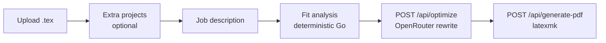

# Haraesume

Web app that tailors a LaTeX resume to a job description and compiles a one-page PDF.

Sign in with Google, upload a `.tex` resume, optionally add extra projects, paste a job description, and review a deterministic fit report. Optimization rewrites the resume through OpenRouter. PDF export compiles that LaTeX with `latexmk` and tightens spacing toward a single page. A separate builder turns a form into a PDF with no model call.


## Features

- **Google sign-in** through Firebase Authentication, with a waitlist gate
- **LaTeX upload** — `.tex` only; the base resume is stored in Firestore
- **Extra projects** — optional pool the optimizer can draw into the Projects section
- **Fit analysis** — deterministic skill coverage, gaps, ATS warnings, and weak bullets (`backend/analysis`)
- **LLM rewrite** — OpenRouter chat completions using `anthropic/claude-sonnet-4`, hardcoded in `backend/config/config.go`
- **PDF export** — `latexmk` first, then `tectonic`, `xelatex`, and `pdflatex`, with single-page tightening
- **Resume builder** — structured form rendered to LaTeX and compiled, with no LLM

## Tailoring flow

1. Upload a UTF-8 `.tex` file, or continue with the saved base resume.
2. Add extra projects, or skip. The optimizer uses this pool only when it is non-empty.
3. Paste the job description. The app saves it, then runs fit analysis.
4. Review the fit report, then run optimization (`POST /api/optimize`).
5. Download the PDF (`POST /api/generate-pdf`).

A returning user with an unexpired base resume starts at the extra-projects step.



## Tech stack

| Layer | Technology |
| --- | --- |
| Frontend | React, TypeScript, Vite, Chakra UI |
| Backend | Go 1.25 (`net/http`) |
| Auth | Firebase Authentication (Google). ID tokens are checked in `backend/auth/firebase.go` |
| Base resume | Cloud Firestore, collection `resumes`, document id = Firebase uid, 7-day `expire_at` |
| Fit analysis | Deterministic Go in `backend/analysis` |
| LLM | OpenRouter at `https://openrouter.ai/api/v1/chat/completions`, model `anthropic/claude-sonnet-4` |
| PDF | TeX Live. Compiler order: `latexmk`, `tectonic`, `xelatex`, `pdflatex` |
| Edge | nginx in the frontend container proxies `/api` and `/health` |
| Hosting | Railway. A `/data` volume holds generated PDFs and the API waitlist file |

## Project structure

```text
haraesume/
├── backend/
│   ├── main.go              # routes and startup
│   ├── analysis/            # deterministic fit report
│   ├── auth/                # Firebase ID token validation
│   ├── builder/             # form-to-PDF resume builder
│   ├── config/              # env loading, model constant, /data paths
│   ├── latex/               # parse, package check, compile
│   ├── llm/                 # OpenRouter client and resume optimizer
│   ├── resume/              # handlers, in-memory state, Firestore storage
│   ├── waitlist/            # JSON waitlist store and admin API
│   ├── agents/              # standalone Python CLI (not called by the API)
│   ├── Dockerfile
│   └── entrypoint.sh
├── frontend/
│   ├── src/App.tsx          # sign-in, waitlist, tailor wizard, builder
│   ├── src/firebase.ts
│   ├── nginx.conf.template  # proxies /api and /health
│   └── Dockerfile
├── functions/               # Firestore trigger: waitlist approval email
├── docker-compose.yml
└── agents.md                # architecture and development harness
```

## Prerequisites

- Go 1.25+
- Node.js 22+ (the frontend image uses Node 22)
- TeX Live with `latexmk` for local PDF compilation (`tectonic`, `xelatex`, and `pdflatex` are fallbacks)
- A Firebase project with Google sign-in and Firestore
- A Google service account that can read and write Firestore
- An OpenRouter API key

## Local development

### Backend

From `backend/`:

```bash
export OPENROUTER_API_KEY="your-openrouter-api-key"
export AUTH_PROVIDER="firebase"
export FIREBASE_PROJECT_ID="your-firebase-project-id"
export GOOGLE_APPLICATION_CREDENTIALS="/absolute/path/to/service-account.json"
go run .
```

The API listens on `http://localhost:3001`. `PORT` overrides the port. The process binds `0.0.0.0`.

`FIREBASE_PROJECT_ID` is required at startup. The Firestore client is created in the background. `GET /health` returns `starting` until that finishes, then `healthy`. Resume routes return 503 until then.

With `AUTH_PROVIDER=firebase`, protected `/api/*` routes require a Firebase ID token (`Authorization: Bearer`). The issuer is `https://securetoken.google.com/<project-id>` and the audience is the project id. With `AUTH_PROVIDER` unset, every request uses the shared anonymous user id and a missing token is allowed.

On startup the process loads the first env file it can read, `backend/.env` or the repo-root `.env`. Variables already set in the environment are left as-is.

### Frontend

From `frontend/`:

```bash
npm install
npm run dev
```

Vite serves `http://localhost:5173` and proxies `/api` and `/health` to `http://localhost:3001`. It reads `frontend/.env` (`envDir: '.'` in `frontend/vite.config.ts`).

```bash
VITE_FIREBASE_API_KEY=your-web-api-key
VITE_FIREBASE_AUTH_DOMAIN=your-project.firebaseapp.com
VITE_FIREBASE_PROJECT_ID=your-firebase-project-id
```

Enable the Google sign-in provider, and add `http://localhost:5173` to the Firebase Authentication authorized domains.

### Using the app

1. Open `http://localhost:5173`.
2. Join the waitlist, or sign in with Google. The tailor and builder screens open only when the waitlist status is `approved`.
3. Upload a `.tex` resume. Later sessions reuse that base resume until its Firestore `expire_at`, seven days after upload.
4. Add extra projects or skip, paste the job description, review the fit report, then optimize and download the PDF.

The **build** tab collects heading, education, experience, projects, skills, and leadership, then calls `POST /api/builder/generate-pdf`.

## Environment variables

### Go API

| Variable | Description |
| --- | --- |
| `OPENROUTER_API_KEY` | Required when an LLM route runs (`/api/optimize`, `/api/generate-application-package`, and company-name lookup during PDF save). |
| `AUTH_PROVIDER` | `firebase` requires Firebase ID tokens. Unset uses a shared anonymous identity. |
| `FIREBASE_PROJECT_ID` | Required. Token audience and Firestore project. |
| `GOOGLE_APPLICATION_CREDENTIALS` | Path to a service account JSON with Firestore access. |
| `GOOGLE_APPLICATION_CREDENTIALS_JSON` | Raw service account JSON. The container entrypoint writes it to `/app/secrets/service-account.json` and points `GOOGLE_APPLICATION_CREDENTIALS` at that file. |
| `PORT` | Listen port. Default `3001`. |
| `APPLICATIONS_ROOT_PATH` | Directory for generated resume PDFs. Default is `<repo>/applications`, or `/data/applications` when `/data` exists. |
| `ADMIN_UIDS` | Comma-separated Firebase uids allowed to call the waitlist admin routes. |
| `RESEND_API_KEY` | Optional. Sends the waitlist signup confirmation from the Go API. |
| `RESEND_FROM_EMAIL` | From address for that email. Default `onboarding@resend.dev`. |

The Go API always sends `anthropic/claude-sonnet-4`. `OPENROUTER_MODEL` is read only by the Python CLI.

### Frontend (Vite, build time)

| Variable | Description |
| --- | --- |
| `VITE_FIREBASE_API_KEY` | Firebase web API key. |
| `VITE_FIREBASE_AUTH_DOMAIN` | Firebase auth domain. |
| `VITE_FIREBASE_PROJECT_ID` | Firebase project id. |

### Python CLI

| Variable | Description |
| --- | --- |
| `OPENROUTER_API_KEY` or `OPENAI_API_KEY` | Enables model calls in the CLI. With both unset, the graph still returns deterministic recommendations. |
| `OPENROUTER_MODEL` | Overrides the CLI default `anthropic/claude-sonnet-4`. |
| `OPENROUTER_BASE_URL` | Overrides the CLI default `https://openrouter.ai/api/v1`. |

## Persistence

| Data | Where |
| --- | --- |
| Base resume | Firestore `resumes/{uid}`: `tex_content`, `uploaded_at`, `expire_at` (seven days after upload), `file_size`. An expired document is treated as missing. Physical deletion depends on a Firestore TTL policy on `expire_at`. |
| Job description, optimized LaTeX, extra projects | Process memory. Saving a job description clears the optimized resume. Uploading a base resume clears both the optimized resume and the extra-project pool. |
| Generated PDFs | `APPLICATIONS_ROOT_PATH/<user-hash>/<company>/`. The intermediate `.tex` is removed after compile. The company folder name comes from an OpenRouter lookup, with a regex heuristic if that call fails. |
| Waitlist used by the API and admin routes | JSON file: `/data/waitlist.json` when `/data` exists, otherwise `state/waitlist.json` relative to the process working directory. |
| Waitlist used by the signup form | Firestore collection `waitlist`, document id = email, field `status` (`pending`, `invited`, or `approved`). |

After sign-in, the app reads the Firestore waitlist document and `GET /api/waitlist/status`, then keeps the stronger status. Only `approved` opens the tailor and builder.

`POST /api/optimize` and `POST /api/generate-application-package` share one limiter: one request per user per minute.

## Docker

```bash
docker compose up --build
```

| Service | Image | Published port |
| --- | --- | --- |
| `frontend` | Node 22 build, then nginx | `8080` |
| `backend` | Go 1.25 binary, Python 3.11, TeX Live, `latexmk` | `3001` |

Compose loads `frontend/.env` and `backend/.env` into the containers. The frontend image also needs `VITE_FIREBASE_API_KEY`, `VITE_FIREBASE_AUTH_DOMAIN`, and `VITE_FIREBASE_PROJECT_ID` as build args. Compose takes those from the shell or a repo-root `.env`. Vite inlines them into the static bundle, so setting them only on the running nginx container does not change the app.

nginx proxies `/api/` and `/health` to `BACKEND_URL`. Compose sets that to `http://backend:3001`. The app is at `http://localhost:8080`.

## Deployment

Production runs on Railway as those two containers. The public service is the frontend. Set `BACKEND_URL` to the backend URL. nginx listens on `PORT` (default `8080` in the image).

On the backend service:

- Set `AUTH_PROVIDER=firebase`, `FIREBASE_PROJECT_ID`, `OPENROUTER_API_KEY`, and `GOOGLE_APPLICATION_CREDENTIALS_JSON`.
- Mount a volume at `/data`. Generated PDFs then default to `/data/applications`, and the API waitlist file defaults to `/data/waitlist.json`. Railway disk without that volume does not survive a redeploy.
- Base resumes stay in Firestore, not on the volume.

`functions/` is a Firebase Cloud Function. When a Firestore `waitlist/{email}` document changes to `approved`, it emails the user through Resend (`RESEND_API_KEY`, `RESEND_FROM_EMAIL`). `APP_URL` defaults to `https://haraesume.com`.

## API

Protected routes expect `Authorization: Bearer <Firebase ID token>` when `AUTH_PROVIDER=firebase`.

| Method | Path | Description |
| --- | --- | --- |
| GET | `/health` | `starting` or `healthy`, plus the app version. Always available. |
| GET | `/api/resume-status` | Whether this user has an unexpired base resume. |
| POST | `/api/upload-resume` | Multipart field `resume`. `.tex` and UTF-8 only. Writes Firestore. |
| POST | `/api/additional-projects` | JSON `{ "projects": [...] }`. Kept in memory for this process. |
| POST | `/api/job-description` | JSON `{ "job_description": "..." }`. |
| POST | `/api/analyze-fit` | Deterministic fit report for the saved resume and job description. |
| POST | `/api/optimize` | LLM rewrite. Rate limited. Returns LaTeX and a changes summary. |
| POST | `/api/generate-pdf` | Compiles the active resume (the optimized version when present) with single-page tightening. Returns a base64 PDF and writes the file under the applications directory. |
| POST | `/api/generate-application-package` | Optimizes, resolves a company name, writes the PDF, and deletes the `.tex`. Rate limited. |
| POST | `/api/builder/generate-pdf` | Compiles the builder form to a base64 PDF. No LLM and no Firestore. Available before Firestore init finishes. |
| POST | `/api/waitlist/notify-signup` | Public. Sends the signup confirmation when Resend is configured. |
| GET | `/api/waitlist/status` | Registers or returns this user in the JSON waitlist. |
| GET | `/api/admin/waitlist` | Admin list. Caller uid must be in `ADMIN_UIDS`. |
| POST | `/api/admin/waitlist/update` | Admin status update. Caller uid must be in `ADMIN_UIDS`. |

## Python CLI

`backend/agents` is a standalone LangGraph CLI that scores a resume against a job description. The Go server does not call it. The backend image still installs its Python dependencies. Graph, tools, and commands are in [backend/agents/README.md](backend/agents/README.md).

## Roadmap

- Move inference off OpenRouter and Claude to DeepSeek's own API.
- Add a persistent project library (projects and bullets, with embeddings). For a pasted job description, the app picks relevant projects and adds role-relevant technical skills, with far less bullet rewriting.

Tracked in [#43](https://github.com/Ackberry/haraesume/issues/43) and [#44](https://github.com/Ackberry/haraesume/issues/44).

## Development

Runtime boundaries and per-area checks are in [agents.md](agents.md).

```bash
cd backend && go test ./...
cd frontend && npm run lint && npm run build
```

## License

MIT
